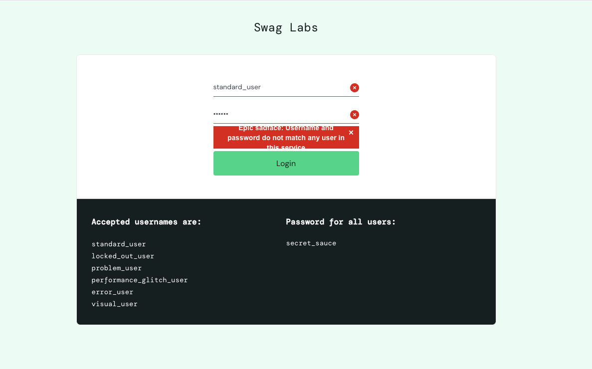
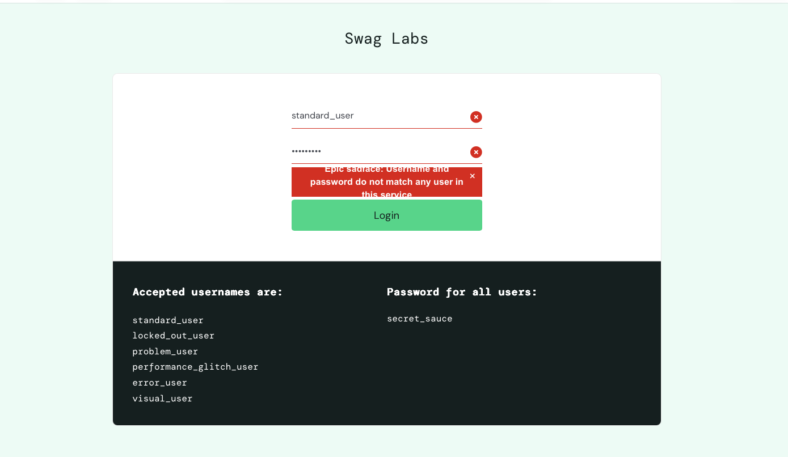

# BUG-001: Login and access error messages are cut off in the error banner

- **Severity:** Low · **Priority:** P3
- **Type:** UI / Text overflow
- **Status:** Open
- **Reported by:** Yasmin Sosa · **Date:** 2026-10-23 (updated 2026-10-25)
- **Related test cases:** TC-04, TC-19 (second occurrence)

## Environment
- URL: https://www.saucedemo.com
- Browsers: Chrome 156.0.8078.48 and Safari 27.0.1 on macOS 27.0.1 (26A434)
- Zoom levels tested: 90%, 100%, 125%
- User: standard_user

## Preconditions
User is on the login page and not logged in.

## Steps to reproduce
1. Go to https://www.saucedemo.com
2. Enter `standard_user` in the Username field.
3. Enter an incorrect password (for example, `abc123`).
4. Click **Login**.

## Expected result
The full error message is displayed and readable inside the red error banner:
"Epic sadface: Username and password do not match any user in this service"

## Actual result
The error message wraps to three lines and the first and last lines are cut off
at the top and bottom of the red banner, so the message is only partially readable.

## Frequency
Always (reproduced 3/3 times in Chrome and Safari, at all zoom levels tested).

## Comparison
Shorter error messages display correctly in the same banner:
- "Epic sadface: Username is required"
- "Epic sadface: Password is required"
- "Epic sadface: Sorry, this user has been locked out."

This suggests the banner has a fixed height that does not expand for longer text.

## Additional occurrence (found 2026-10-25 during TC-19)
The same issue affects the access error shown after logout:
- Steps: log in → Logout → click the browser Back button, or open https://www.saucedemo.com/inventory.html directly.
- Message: "Epic sadface: You can only access '/inventory.html' when you are logged in"
- Result: the text is cut off at the top and bottom of the banner (Chrome and Safari).
- This confirms the banner does not adjust to longer messages.

## Impact
Users who enter the wrong password, or who try to return to the store after logging out,
may not be able to read why access failed. This can cause confusion and repeated attempts.
The issue would likely get worse in localized versions, where translated text is often longer.

## Evidence

