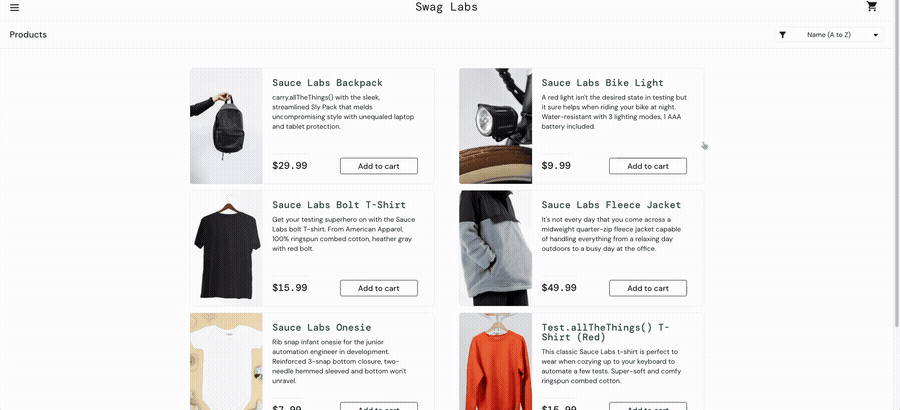

# BUG-002: Product buttons still show "Remove" after Reset App State empties the cart

**Severity:** Medium · **Priority:** P2
**Type:** Functional / UI state sync
**Status:** Open
**Reported by:** Yasmin Sosa · **Date:** 2026-10-23
**Related test case:** TC-0XX (Reset App State clears cart)

## Environment
- URL: https://www.saucedemo.com
- Browsers: Chrome 156.0.8078.48 on macOS 27.0.1 (26A434) — Safari 27.0: Always (reproduced in Chrome and Safari)
- User: standard_user

## Preconditions
User is logged in and on the Products page with an empty cart.

## Steps to reproduce
1. Log in as `standard_user` / `secret_sauce`.
2. Click **Add to cart** on 2 products (for example, Sauce Labs Backpack and Sauce Labs Bike Light).
3. Confirm the cart badge shows **2** and both buttons now show **Remove**.
4. Open the menu (☰) and click **Reset App State**.

## Expected result
The cart is emptied, the cart badge disappears, **and** the buttons for both products change back to **Add to cart**.

## Actual result
- The cart badge disappears and the cart page is empty (correct).
- The product buttons still show **Remove** (incorrect), so the page shows the products as if they were still in the cart.
- The buttons only update after a page refresh (Cmd + R).
- Clicking one of these stale **Remove** buttons changes it to **Add to cart** without any cart change, which confirms the button is showing an outdated state.

## Frequency
Always (reproduced 3/3 times in Chrome).

## Impact
After a reset, customers see conflicting information: an empty cart, but product buttons that say the items are still added. This can lead them to believe items are in their cart when they are not, which may cause abandoned or incomplete orders.

## Suggested area to check
The product list does not appear to re-render when the app state is reset.
(Observation based on behavior only; source code not reviewed.)
## Evidence

🎥 [Full screen recording (MP4)](./bug-002-video.mp4)
