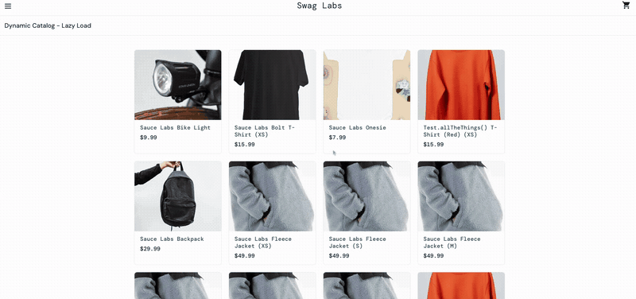

# BUG-003: Dynamic Catalog (Lazy Load) shows the same products more than once
- **Severity:** Medium · **Priority:** P3
- **Type:** Functional / Data display
- **Status:** Open — needs confirmation from Product
- **Reported by:** Yasmin Sosa · **Date:** 2026-10-23

## Environment
- URL: https://www.saucedemo.com/dynamic-catalog-lazy-load.html
- Browsers: Chrome 156.0.8078.48 and Safari 27.0 on macOS 27.0.1 (26A434)
- User: standard_user

## Preconditions
User is logged in.

## Steps to reproduce
1. Log in as `standard_user` / `secret_sauce`.
2. Open the menu (☰) → **Dynamic Catalog** → **Lazy Load**.
3. Scroll down slowly until more products load.
4. Compare the product names, sizes, and order in the list.

## Expected result
Each product variant appears only once in the catalog, so customers see a clear, non-repeating list.

## Actual result
- After more items load, the list repeats the same sequence of products in the same order:
  Sauce Labs Bike Light → Sauce Labs Bolt T-Shirt (XS) → Sauce Labs Onesie →
  Test.allTheThings() T-Shirt (Red) (XS) → Sauce Labs Backpack →
  Sauce Labs Fleece Jacket (XS) → (S) → (M).
- These products appear again exactly as they did at the top of the list.
- The list also shows size variants (Fleece Jacket XS–XXL, Bolt T-Shirt and Test.allTheThings() T-Shirt in several sizes), which looks intentional. The defect is the exact repetition of the same variants.

## Frequency
Always (reproduced every time I scrolled the Lazy Load list in Chrome and in Safari).

## Impact
Repeated products make the catalog look broken and make it hard for customers to know how many options really exist. In a real store, this could also mean the "load more" logic requests the same page of results twice.

## Additional observations (questions for Product, not defects)
- Lazy Load cards show only an image, name, and price. They have no **Add to cart** button and are not clickable, unlike the main Products page. Is this list meant to be view-only?
- The main Products page shows 6 products, while Lazy Load shows size variants as separate items. Is this a different catalog by design?

## Notes
Lazy Load may use intentional test data, so this is logged as a possible defect for Product to confirm.
Observation based on behavior only; source code not reviewed.

## Evidence

🎥 [Full screen recording (MP4)](./bug-003-video.mp4)
