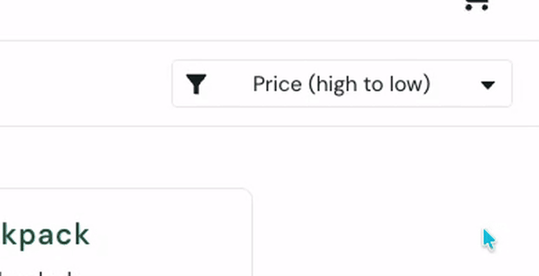

# BUG-004: Sort dropdown does not open when clicking the arrow icon, although the cursor shows it as clickable

- **Severity:** Low · **Priority:** P3
- **Type:** UI / Usability
- **Status:** Open
- **Reported by:** Yasmin Sosa · **Date:** 2026-10-25
- **Related test case:** TC-06 (found during execution of the sort test cases)
## Environment
- URL: https://www.saucedemo.com/inventory.html
- Browsers: Chrome 156.0.8078.48 and Safari 27.0 on macOS 27.0.1 (26A434)
- User: standard_user

## Preconditions
User is logged in and on the Products page.

## Steps to reproduce
1. Log in as `standard_user` / `secret_sauce`.
2. Move the mouse over the arrow icon (▼) on the right side of the sort dropdown.
3. Click the arrow icon.
4. Move the mouse over the sort text (for example, "Price (high to low)") and click it.

## Expected result
Clicking anywhere on the sort control, including the arrow icon, opens the sort menu.
The cursor shows a pointer only where clicking performs an action.

## Actual result
- Over the arrow icon (▼), the cursor changes to a pointer (hand), which suggests it is clickable, but clicking it does **not** open the sort menu.
- Over the sort text, the cursor shows a standard arrow, but clicking it **does** open the menu.
- The cursor feedback is the opposite of the actual behavior.

## Frequency
Always (reproduced in Chrome and in Safari).

## Impact
Users naturally click the arrow to open a dropdown. When nothing happens, they may think sorting is broken and stop using it. The misleading pointer cursor makes the problem more confusing.

## Workaround
Click the sort text instead of the arrow icon.

## Notes
- Sorting itself works correctly (TC-06 to TC-09 pass); this defect affects only how the menu is opened.
- Keyboard access to the sort control was not tested.
- Observation based on behavior only; source code not reviewed.

## Evidence

🎥 [Screen recording (MP4)](./bug-004-video.mp4)
