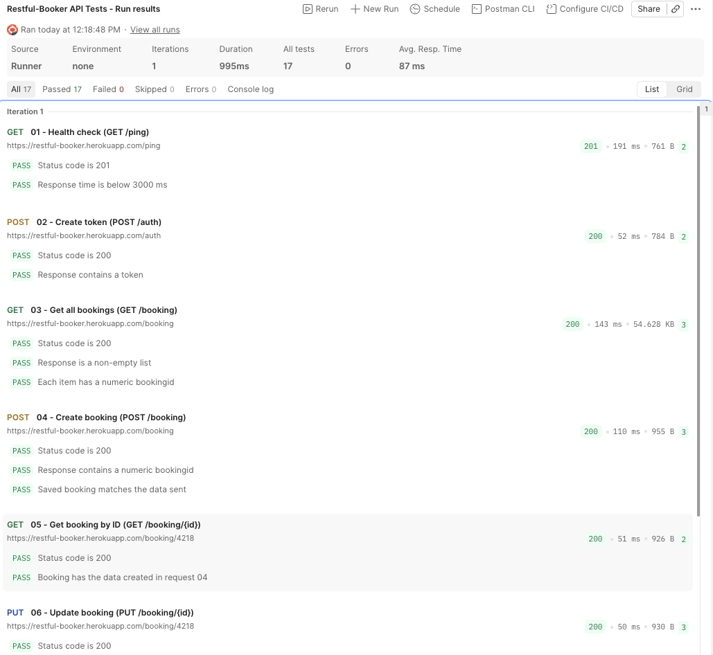

# API Testing — Restful-Booker (Postman)

- **Tested by:** Yasmin Sosa · **Date:** 2026-10-28
- **API under test:** [Restful-Booker](https://restful-booker.herokuapp.com), a public practice API for hotel bookings ([API documentation](https://restful-booker.herokuapp.com/apidoc/index.html))
- **Tool:** Postman (desktop app) · Collection Runner
- **Collection:** [Restful-Booker_API_Tests.postman_collection.json](./Restful-Booker_API_Tests.postman_collection.json)

## Goal
Validate the full booking lifecycle through the API: authentication, create, read, update, and delete (CRUD), including a negative test that confirms a deleted booking can no longer be found.

## Test flow
The requests run in order and pass data to each other through collection variables:

1. **02 - Create token** saves the auth `token`, used by **06 (PUT)** and **07 (DELETE)**.
2. **04 - Create booking** saves the new `bookingId`, used by **05 to 08**.

| # | Request | Method and endpoint | What the tests check | Tests |
|---|---|---|---|---|
| 01 | Health check | `GET /ping` | Status 201 · response time below 3000 ms | 2 |
| 02 | Create token | `POST /auth` | Status 200 · token is a non-empty string · token saved | 2 |
| 03 | Get all bookings | `GET /booking` | Status 200 · non-empty list · every item has a numeric `bookingid` | 3 |
| 04 | Create booking | `POST /booking` | Status 200 · numeric `bookingid` · saved data matches the data sent · ID saved | 3 |
| 05 | Get booking by ID | `GET /booking/{id}` | Status 200 · booking has the data created in 04 | 2 |
| 06 | Update booking | `PUT /booking/{id}` (auth) | Status 200 · changed fields updated · unchanged fields keep their values | 3 |
| 07 | Delete booking | `DELETE /booking/{id}` (auth) | Status 201 | 1 |
| 08 | Get deleted booking | `GET /booking/{id}` | Status 404 (negative test) | 1 |

## Results
| Metric | Result |
|---|---|
| Requests run | 8 / 8 |
| Tests passed | **17 / 17 (100%)** |
| Tests failed | 0 |
| Total run duration | 995 ms |
| Average response time | 87 ms |

## Observations
- **Non-standard status codes (documented API behavior):** `GET /ping` and `DELETE /booking/{id}` return **201 Created** instead of the more common 200 or 204. The tests follow the API documentation, and the test names make this explicit.
- **Test data resets every 10 minutes:** the API deletes all tokens and bookings on a schedule. Running a single request after a pause can return **403 Forbidden** (expired token) or **404 Not Found** (deleted booking). Running the whole collection in order with the Collection Runner avoids this.
- **Verified a negative test against a false positive:** request 08 is only valid if `{{bookingId}}` resolves to the real booking deleted in 07. The URL variable was checked so the 404 comes from the deleted booking, not from a malformed request.
- **Test data:** fictional guest data only ("Test User"). The login credentials are the public test credentials published in the API documentation.

## How to run
1. In Postman: **Import** and select `Restful-Booker_API_Tests.postman_collection.json`.
2. Open the collection, click **Run**, keep all 8 requests selected in order, and click **Start run**.
3. No setup is needed: `baseUrl` is included, and `token` and `bookingId` are filled in automatically during the run.
